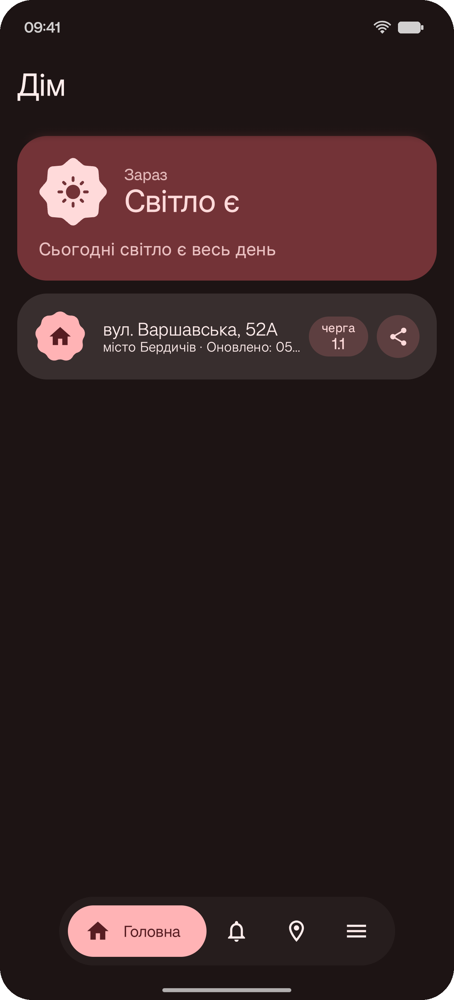
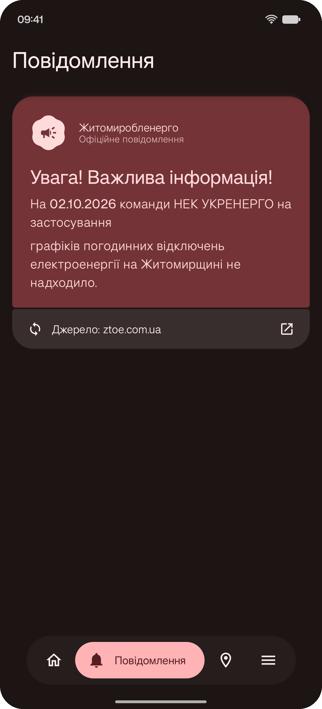
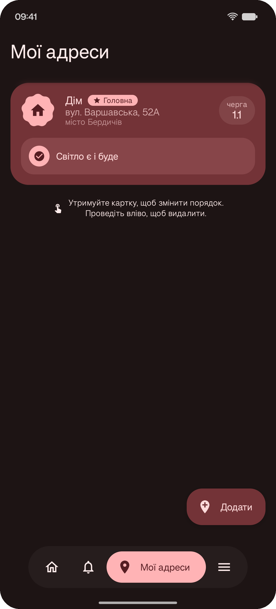
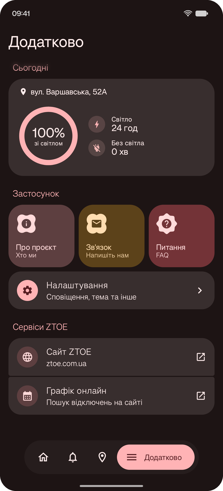

<p align="center">
  
</p>

<h1 align="center">СвітлоЄ?</h1>

<p align="center">
  <b>Відкрив і одразу бачиш, чи є світло вдома, коли його вимкнуть і коли повернуть.</b><br>
  Графіки відключень Житомиробленерго для всієї області.
</p>

<p align="center">
  <a href="https://github.com/dmitthedazed/SvitloYE/releases/latest"></a>
  <a href="https://github.com/dmitthedazed/SvitloYE/releases"></a>
  <a href="https://github.com/dmitthedazed/SvitloYE/actions/workflows/tests.yml"></a>
  
  
</p>

<p align="center">
  <a href="https://github.com/dmitthedazed/SvitloYE/releases/latest"><b>Завантажити APK</b></a> ·
  <a href="https://dmitthedazed.github.io/SvitloYE/">Сайт</a> ·
  <a href="https://github.com/dmitthedazed/SvitloYE/issues/new/choose">Повідомити про проблему</a>
</p>

<table>
  <tr>
    <td align="center" width="25%"></td>
    <td align="center" width="25%"></td>
    <td align="center" width="25%"></td>
    <td align="center" width="25%"></td>
  </tr>
  <tr>
    <td valign="top"><b>Статус зараз</b><br><sub>Є світло чи ні, скільки до наступної зміни і підсумок дня для вашої черги.</sub></td>
    <td valign="top"><b>Новини</b><br><sub>Оголошення Житомиробленерго з посиланням на джерело.</sub></td>
    <td valign="top"><b>Кілька адрес</b><br><sub>Дім, робота, батьки. Пошук за адресою, геолокацією або QR-кодом.</sub></td>
    <td valign="top"><b>Статистика</b><br><sub>Скільки годин зі світлом і без, сервіси Житомиробленерго під рукою.</sub></td>
  </tr>
</table>

## Що вміє

- **Сповіщення** перед вимкненням і ввімкненням, про зміну графіка, постійний статус у шторці
- **Віджети**: компактний статус, поточний стан і графік на день
- **Плитка** у швидких налаштуваннях
- **Android Auto**: графік на екрані авто
- **Material You**: кольори зі шпалер, світла й темна теми
- **Вся область**: Житомир, Бердичів, Коростень, Звягель і всі населені пункти, які обслуговує Житомиробленерго

## Встановлення

1. Завантажте `app-debug.apk` з [останнього релізу](https://github.com/dmitthedazed/SvitloYE/releases/latest).
2. Дозвольте встановлення з невідомих джерел, якщо Android попросить.
3. Відкрийте застосунок і оберіть адресу.

> [!NOTE]
> Застосунок неофіційний. Дані беруться з відкритих джерел АТ «Житомиробленерго». Якщо щось не збігається, орієнтуйтеся на [ztoe.com.ua](https://www.ztoe.com.ua).

<details>
<summary>Що нового у 2.0</summary>

- Нова система сповіщень: точні будильники, детектор змін графіка, менше дублів
- Нові віджети з адаптивним дизайном
- Material 3 Expressive, нова навігація і новий логотип
- Анімований splash-екран і новий онбординг
- Правильний київський час незалежно від налаштувань телефону

</details>

<details>
<summary>Під капотом</summary>

| | |
| --- | --- |
| Мова | Kotlin |
| UI | Jetpack Compose, Material 3 Expressive |
| Архітектура | Clean Architecture, MVVM |
| Мережа | Retrofit |
| Фонова робота | AlarmManager, WorkManager, Foreground Service |
| Віджети | Jetpack Glance |
| QR-сканер | CameraX, ML Kit |
| Авто | Android for Cars App Library |

Збірка (потрібен JDK 21):

```sh
./gradlew assembleDebug
```

Як долучитися: [CONTRIBUTING.md](CONTRIBUTING.md).

</details>

## Ліцензія

[MIT](LICENSE)
